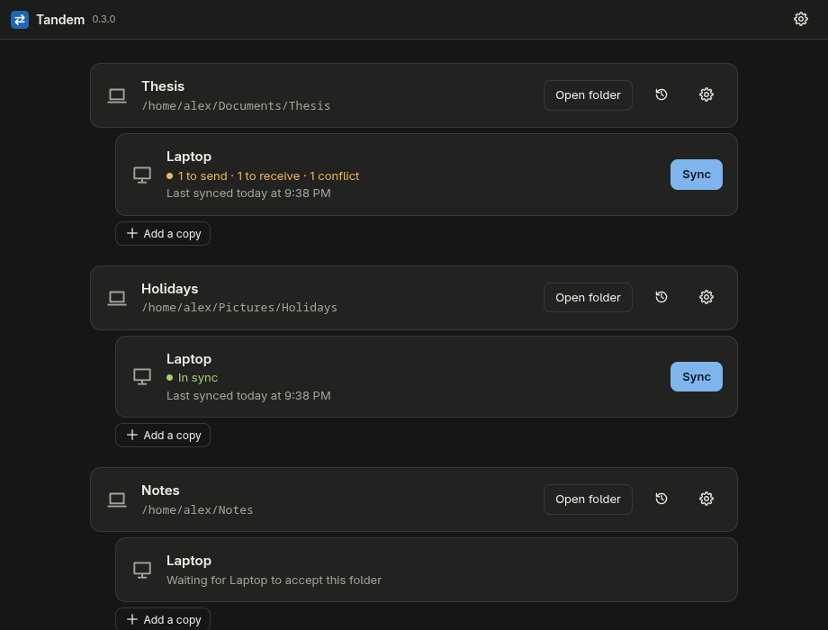
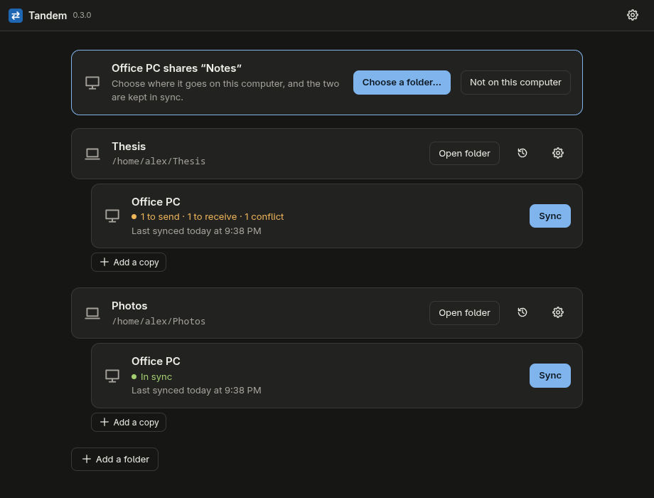
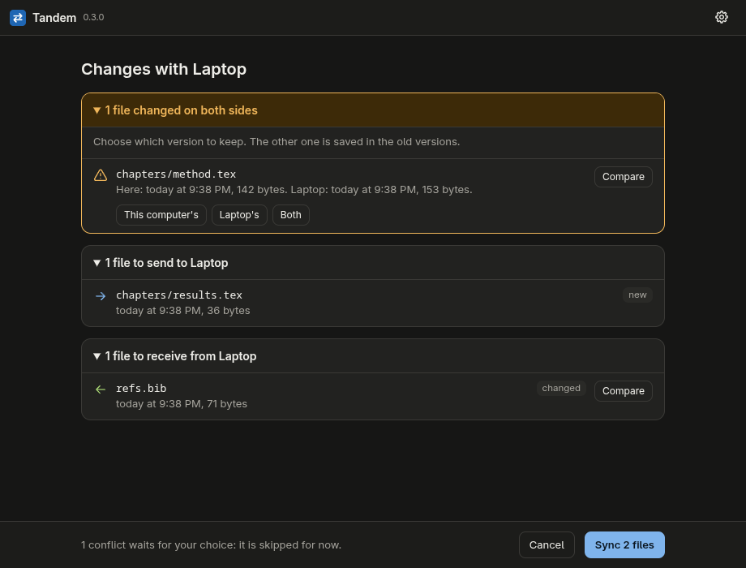
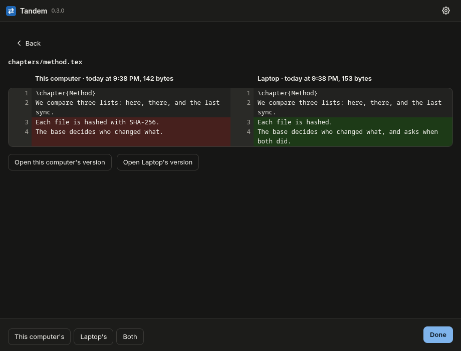

# Tandem

Keep folders the same on several computers, over your own network. Nothing goes to the cloud.

Made for people who work in the same folder from two computers and are tired of copying the last version
by hand. Tandem shows every change before it makes it, asks when both sides changed the same
file, and never overwrites or deletes anything without keeping a copy.



## How it works

1. **Choose the folder** on each computer (on the second one an empty folder is fine).
2. **Pair the other computer**: one shows a code, the other types it. Once, then they know each other.
   Both must be on the same network, with Tandem open, to sync.
3. **Sync**: Tandem compares the two copies and lists what it will do: files to send, to receive, deleted
   on the other side, and conflicts (changed on both sides) with three answers each: this computer's, the
   other's, or both. Text files can be compared side by side first.
4. **Status**: between syncs, the home screen says what a sync would do with each copy ("2 to send · 1 to
   receive"), or "can't tell" with why when it can't see a side (the other computer is off, or a folder
   can't be watched). It never says "in sync" without seeing both sides.
5. **Old versions**: every replaced or deleted file is kept for 90 days (`.tandem/old/` in the folder) and
   can be put back from the window.
6. **Several folders**: add as many as you like, each with its own copies. A computer paired once is offered
   a folder with one click ("Share"); on that computer, Tandem shows "Office PC shares 'Thesis'" and you
   choose where it goes there: a new folder or one you already sync. The two are then linked whatever their
   names and places, and the other computer reaches only the folders shared with it.

Several copies are fine: three computers, four, and so on. Each is synced on its own.

## Screenshots

| | |
|---|---|
|  |  |
| A folder offered by another computer: choose where it goes here. | Every change is shown before it is made, conflicts first. |
|  | |
| A conflict compared side by side, before choosing. | |

## What it does not do (yet)

- It does not sync in the background: you start each sync and see it.
- No USB drives: a copy is always on another computer, and both must be on together to sync. Copies on
  drives set up with Tandem 0.2.0 are forgotten; their files stay on the drives.
- It does not merge two versions of a file into one. "Keep both" puts them side by side in the folder.
- Empty folders, links and file permissions are not synced.
- No Android app released yet. One runs, in development: `shell/android/main.ts`, packed into an APK by
  nodeapk (not published yet: Node runs on the phone, the window in a WebView). It pairs by scanning the QR
  code a computer shows; it can't open files in other apps yet.
- Updates install themselves only in the AppImage (and on Windows and macOS): an .rpm or .deb says when a new
  version is out, with a button to download it.

## Develop

Node 24, pnpm, [Vite+](https://viteplus.dev) (`vp`).

```bash
vp install
```

```bash
vp run dev
```

- `vp test` runs the tests, `vp lint` the linter and type checker.
- `vp run browser` starts Tandem without Electron and prints a link for a normal browser
  (`node tools/dev.ts --state=<folder>` for a second copy with its own files).
- `vp run appimage` builds the Linux AppImage, `vp run install-app` also installs it for the current user.
- `vp run dist` builds every package of the current system into `dist/packages/`.

Building packages, releasing, updates, and what has been tried: [docs/packaging.md](docs/packaging.md).

```
src/              the sync itself: no Electron, tested (plan, apply, store, peer, core…)
app/ui/           the window: one page, its styles and words
shell/electron/   all the Electron code: window, menus, updates, packaging
tools/            scripts: dev runner, install, translations
tests/            vp test
locales/app/      translations (.po), see docs/translating.md
docs/             design.md (how the sync decides, the status), network.md (pairing, encryption, protocol),
                  packaging.md (packages, releases, updates)
```
