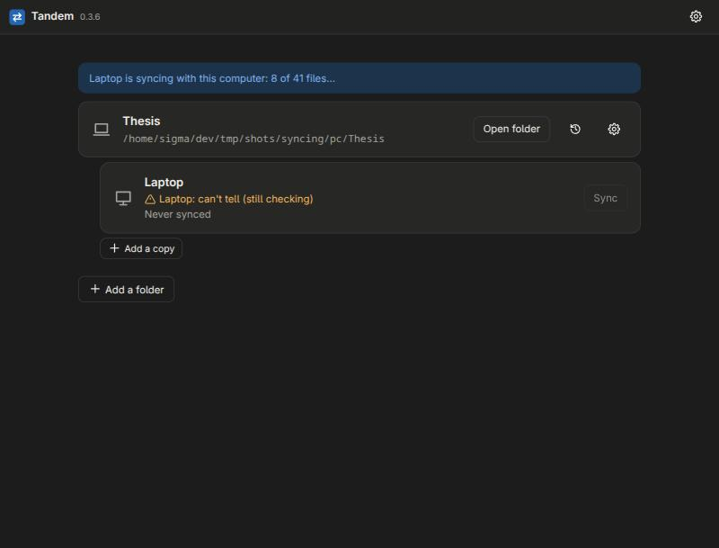

## No sync starts on a folder that's already syncing

While another computer syncs a folder with this one, that folder's **Sync** button waits, and the notice at the top says how far the other computer is. It works both ways: a computer busy syncing a folder tells the other one so, instead of both comparing a folder that's still changing.

*Office PC while Laptop syncs the "Thesis" folder with it (sample files).*

- When the other computer cancels, or closes its review without syncing, the notice goes away at once.
- The same between any two devices: computer and computer, phone and computer.
- With a device still on an older Tandem, syncing works as before.
