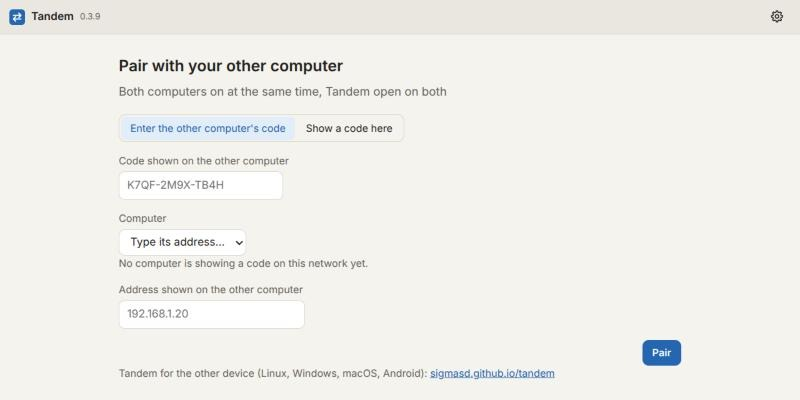

## Android: install this one anew

The Android app has a new identity (`io.github.sigmasd.tandem`), in preparation for F-Droid. Android sees it as another app, so it doesn't update the old Tandem: it installs next to it. **Your folders and files stay where they are**, but the new app starts without the old one's settings:

1. In the old Tandem, sync one last time, then uninstall it.
2. Install this one, and pair it with your computer again (scan the QR code).
3. Choose the same folder on the phone. The next sync compares the two copies; files that are the same are left alone.
4. On the computer, forget the old phone in the settings.

Files that differ are shown for you to choose, and nothing is replaced or deleted without a copy kept. But the new app doesn't know what you deleted before: a file deleted on one side and not yet on the other comes back. That is why to sync first.

This happens once. Computers update as usual.

## Where to get Tandem for your other devices

The screen that adds a copy of a folder, and About, now link to [Tandem's website](https://sigmasd.github.io/tandem/), which has the download for each system.

*Adding a copy of a folder (sample folder).*

## Also

- The Android app no longer carries the desktop app's code.
- Node, which runs Tandem on the phone, is built in a way that no longer depends on the disk it is built on. F-Droid's own build of this version hasn't been compared with this one yet.
